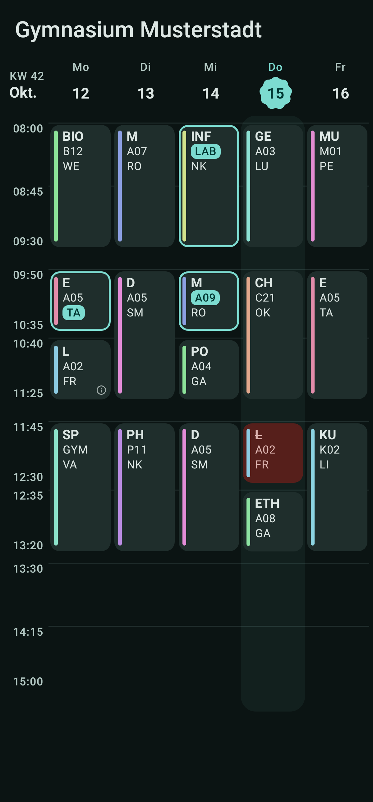
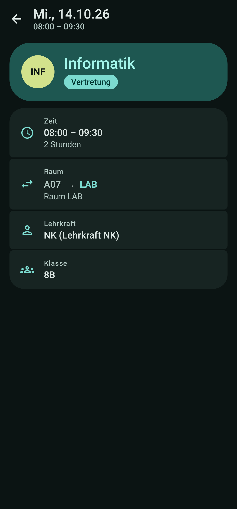
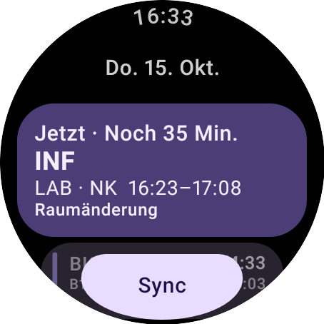
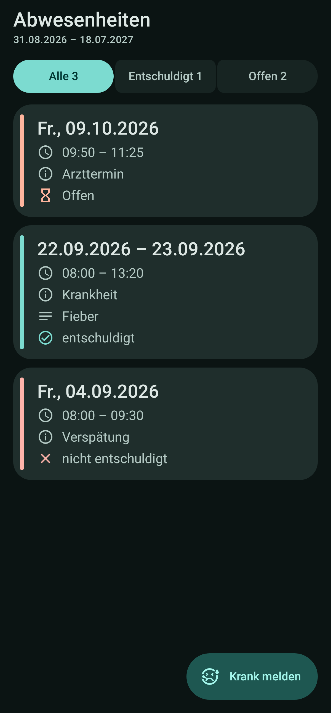
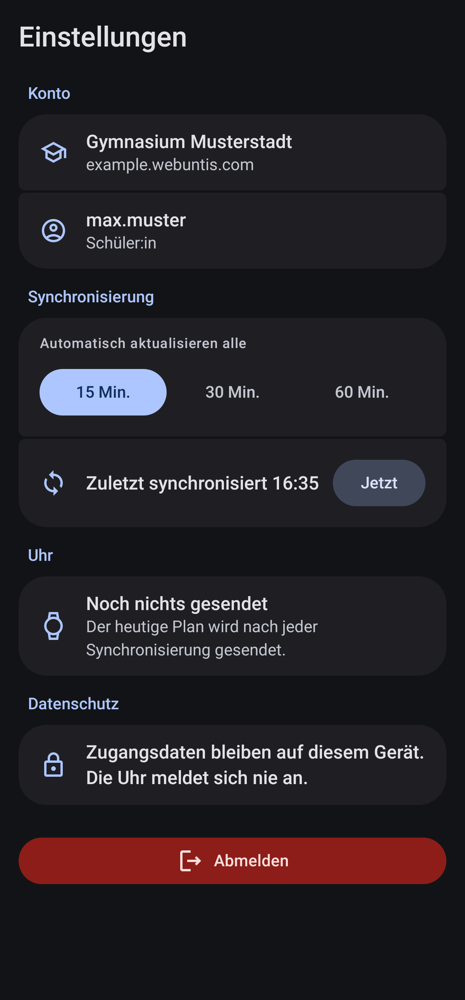
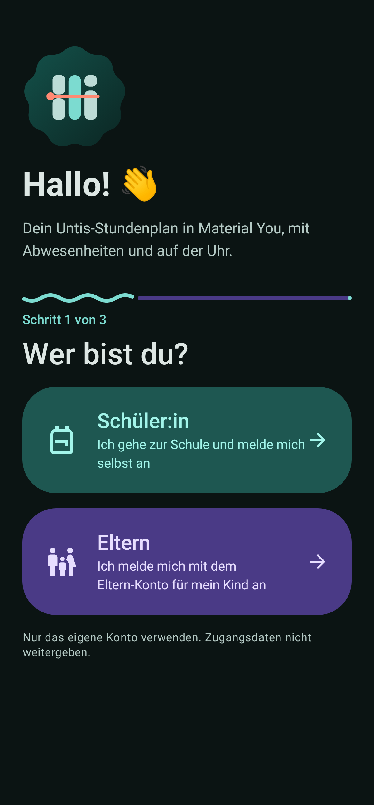
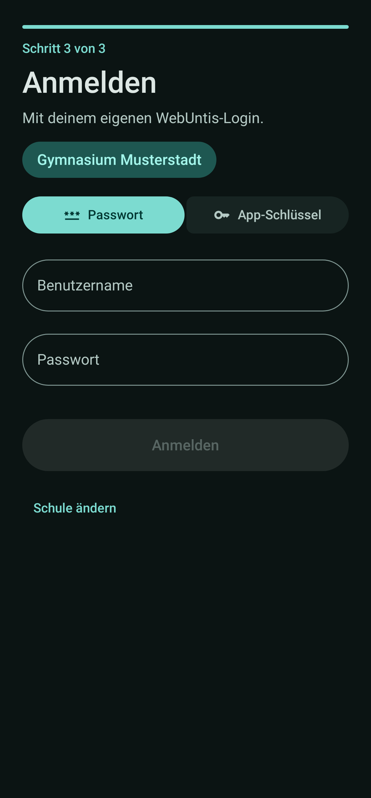

<div align="center">


# Material-Untis

**Your Untis timetable in Material 3 Expressive – on your phone and on your wrist.**

[](https://github.com/david-x3d/Material-Untis/releases/latest)
[](#installation)
[](#installation)
[](#development)





</div>

A personal timetable for one WebUntis account. The phone app signs in, keeps a local cache and sends today's lessons to the watch. The watch never talks to WebUntis itself.

## What you get

| | |
|---|---|
| **Week grid** | Like Untis: double periods joined, substitutions highlighted, cancelled lessons, a "now" line, swipe between weeks |
| **Holidays & locked weeks** | School holidays and weeks your school has restricted are shown as such, not as empty days |
| **Lesson details** | Subject, teacher, room, class, info, substitution text and times |
| **Absences** | Current school year, filtered by excused / unexcused / open – and **Report sick** straight to the school |
| **Accounts** | Students and parents (parents see their child automatically) |
| **Sign-in** | Password, or the app secret from your Untis QR code (TOTP) – scan it or paste it |
| **Colours** | Automatic subject colours (shuffle) or pick your own per subject; Material-Untis theme or wallpaper colours |
| **Offline** | Room cache with an offline banner – the last timetable is always there |
| **Background sync** | Every 15, 30 or 60 minutes; today's lessons go to the watch after every sync |
| **Wear OS** | Now/next card with countdown, today's lessons, sync button and a next-lesson complication |
| **Demo mode** | Try everything with sample data, no account needed |

<details>
<summary><b>More screenshots</b></summary>

<p>
  
  
  
  
</p>

Sample data only (invented school and timetable). Rendered from the real Compose screens with Robolectric – see [Screenshots](#screenshots).

</details>

## Installation

Both APKs are attached to the [latest release](https://github.com/david-x3d/Material-Untis/releases/latest).

### Phone

1. Download `Material-Untis-phone-….apk` on your phone and open it.
2. Allow installing from this source when Android asks.
3. Find your school (search, or enter server + school name), choose student or parent, sign in.

### Watch

Install the phone app first. Then sideload `Material-Untis-wear-….apk` onto the watch, e.g. with [wireless debugging](https://developer.android.com/training/wearables/get-started/debugging):

```bash
adb connect <watch-ip>:<port>
adb -s <watch> install -r Material-Untis-wear-v0.5.0.apk
```

Both APKs come from the same build, so they share the signing key and the `applicationId` – that's what lets them find each other over the Wear OS Data Layer. Open the app on the watch and tap **Sync**, or wait for the phone's next sync.

<details>
<summary><b>Trying it without an account</b></summary>

On the start screen, tap **Try the app / Settings** and turn on **Demo mode** (also under **Settings → Demo mode** once signed in).

The demo timetable has cancellations, room / teacher / subject changes, exams, school events, office hours, stand-by duty and break supervision. Next week shows holidays. Absences cover open, excused and unexcused entries as well as multi-day illness.

Sick reports you send in demo mode show up in the list and survive a refresh until the app restarts – they are never sent to the school. The switch stays on across restarts. Your real sign-in and cached school data are kept.

</details>

## How it works

- **Phone is the source of truth.** `:app` talks to WebUntis, caches everything in Room and pushes a small, gzipped summary of today (subject, room, teacher, times, status, info) to `/dayline/today` on the Data Layer. Never credentials.
- **Plain JSON-RPC.** `POST https://<host>/WebUntis/jsonrpc.do?school=<school>` with `authenticate`, `logout`, `getTimetable`, `getLatestImportTime` and `getTimegridUnits`. The session is the `JSESSIONID` cookie from `authenticate`.
- **One retry, no loops.** On an auth error or HTTP 401 the app signs in once more, then shows the error.
- **Untis time, not device time.** Dates are `YYYYMMDD`, times are ints (`720` = 07:20). The device time zone is only used for "now".
- **School search** uses `searchSchool` on `mobile.webuntis.com/ms/schoolquery2`, like the official mobile clients. Entering server + school by hand always works.
- **Secret login** turns the QR code's `key` (hex or base32) into a TOTP (SHA-1, 6 digits, 30 s) and sends it as the password to the same `authenticate` call.

## Privacy

Material-Untis talks only to your school's WebUntis server (and the school search, if you use it).

- Password / secret live in EncryptedSharedPreferences on the phone only
- Nothing sensitive is sent to the watch
- No analytics, no ads, no crash SDKs
- Cleartext HTTP is disabled
- Logging out removes the saved timetable and sign-in data from the device

## Development

```
core/   JSON-RPC client, domain models, Room cache, encrypted credentials, WatchPayload codec
app/    phone UI (Compose, Material 3 Expressive), WorkManager sync, Data Layer sender
wear/   Wear OS UI, Data Layer receiver, next-lesson complication
docs/   README screenshots
```

`applicationId` is `dev.x3d.dayline` on **both** APKs – required for sideloaded Data Layer sync.

You need JDK 17 (Android Studio's JBR works), Android SDK 36 with Build-Tools, and a Wear OS 3+ (API 30+) emulator image or a real watch.

```bat
gradlew.bat :core:test
gradlew.bat :app:assembleDebug
gradlew.bat :wear:assembleDebug
```

On macOS / Linux, run the same tasks with Gradle 8.13 (`gradle :app:assembleDebug`). The APKs land in `app/build/outputs/apk/debug/` and `wear/build/outputs/apk/debug/`. Install the phone APK first, then the watch APK:

```bat
adb -s <phone> install -r app\build\outputs\apk\debug\app-debug.apk
adb -s <watch> install -r wear\build\outputs\apk\debug\wear-debug.apk
```

The camera permission (QR scan) is optional – the secret can always be pasted.

### Tests

`:core` unit tests cover Untis time parsing (`7`, `720`, `930`, `1345`), cancelled / irregular mapping, absences, QR parsing, the one-shot session retry, cache transactions and the WatchPayload gzip round-trip. Fixtures live in `core/src/test/resources/fixtures` (anonymized).

### Screenshots

The images in this README are rendered by Robolectric tests from the real Compose screens:

```bat
gradlew.bat :app:testDebugUnitTest :wear:testDebugUnitTest -Pscreenshots
```

### Publishing a new version

1. Bump `versionCode` / `versionName` in `app/build.gradle.kts` and `wear/build.gradle.kts`.
2. Tag and push: `git tag v0.6.0 && git push origin main --tags`
3. GitHub Actions runs the `:core` tests, builds both release APKs and publishes the release.

Without signing secrets, release builds are debug-signed – fine for sideloading, but the key changes per machine, so updates won't install over each other. For a stable key, add these repository secrets:

| Secret | Used for |
|---|---|
| `RELEASE_KEYSTORE_BASE64` | the keystore (`.jks`), base64-encoded |
| `RELEASE_KEYSTORE_PASSWORD` | keystore password |
| `RELEASE_KEY_ALIAS`, `RELEASE_KEY_PASSWORD` | the signing key inside it |

## Disclaimer

Unofficial community project, not affiliated with Untis GmbH. Use your own account only and don't share your credentials.
